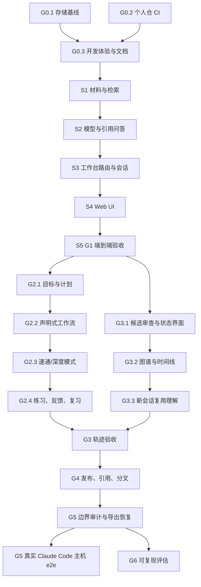

# Episteme Personal 目标计划

依据 `Episteme-Personal-Goal-Mode-PRD` v1.1。状态取值：Backlog / Ready / In Progress / Blocked / Review / Done。

"Review"表示已提交 Draft PR、等人审；"Done"表示已合并且通过验收。功能已编码不等于已验收。

## 任务依赖图

## 任务

| 任务 | 状态 | 依赖 | 验收 | PR |
| ---- | ---- | ---- | ---- | ---- |
| G0.1 存储基线 | Review | 无 | 单 SQLite 文件，跨进程唯一持有者，Windows CI 通过 | [#2](https://github.com/Jiarong-Song233/Episteme/pull/2) |
| G0.2 个人仓 PR 检查 | Review | 无 | PR 标题检查，无 Issue 门禁 | [#1](https://github.com/Jiarong-Song233/Episteme/pull/1) |
| G0.3 开发体验与文档 | In Progress | G0.1 | 文档无过时命令，有计划和进度文件 | 本分支 |
| S1 材料与检索 | Done | G0.3 | TXT、MD、文本 PDF；可定位切块；去重；删除一致；中英文检索 | |
| S2 模型与引用问答 | Done | S1 | 模拟与真实模型同一接口；引用校验；证据不足；超时、失败、预算 | |
| S3 工作台路由与会话 | Done | S2 | 空间、材料、问答的路由；重启后恢复 | |
| S4 Web UI | Done | S3 | 空间导航、上传、聊天、来源面板、历史、候选审查、错误反馈 | |
| S5 G1 端到端验收 | Done | S4 | PRD G1 流程：自动化浏览器测试 + 一次真实模型演示 | |
| G2.1 目标与计划 | Review | S5 | 可编辑计划，版本化 | |
| G2.2 声明式工作流 | Review | G2.1 | 声明式、可恢复；先审计 MindLink #20/#29/#11/#28/#6 的约定 | |
| G2.3 速通/深度模式 | Review | G2.2 | 同一材料走两种模式，深度可切直接讲解 | |
| G2.4 练习、反馈、复习 | Review | G2.3 | 分开记录正确率、模型估计、用户确认 | |
| G3.1 候选审查与状态界面 | Review | S5 | 修改、驳回、冲突保留 | `feat/workbench-understanding` |
| G3.2 图谱与时间线 | Review | G3.1 | 单一图谱多视图 | `feat/workbench-understanding` |
| G3.3 新会话复用理解 | Review | G3.2 | 新对话能引用已确认理解，并标明来源 | `feat/workbench-understanding` |
| G4 发布、引用、分叉 | Review | G3 | A 发布，B 引用并分叉，可追溯，A 不被覆盖 | `feat/workbench-sharing` |
| G4 撤回后保留引用者看到的作者名 | Review | G4 | 引用过的人在作者撤回后仍看到名字，没有引用的人不变 | `feat/cited-author-names` |
| G5 边界审计与导出恢复 | Review | G4 | 非教学场景不改 Core；导出、导入、恢复有测试；SAIR 贡献候选清单 | `feat/boundary-and-recovery` |
| G5 真实主机 e2e | Review | G5 审计 | 真实 Claude Code 连接 MCP（SAIR #32）。无头模式已跑通；交互模式和 Codex 未验证 | `feat/boundary-and-recovery` |
| G6 可复现评估：同模型基线 | Review | G5 | 固定材料和任务，方法、结果、局限和下一轮依据见[第一轮报告](../research/evaluation/round-1.md) | `feat/evaluation` |
| G6 第一轮发现的修复 | Review | G6 基线 | 同义改写题从 6/18 到 15/18，引用不再截断，对话步骤的空回复查明根因。见[第二轮报告](../research/evaluation/round-2.md) | `fix/evaluation-findings` |
| G6 与成熟产品对比 | Review | G6 基线 | 经用户授权运行 Open WebUI 0.12.5，四种配置，含能力走查。结果和局限见[第三轮报告](../research/evaluation/round-3.md) | `feat/evaluation-openwebui` |

## 能力差距（2026-11-02 盘点）

| PRD 能力 | 已有 | 缺口 |
| ---- | ---- | ---- |
| 空间 | 线程 `scope`、场景记录 | 空间实体、归档 |
| 材料 | `Source`（已蒸馏的原文，不可删） | 上传、PDF、切块、去重、删除、索引 |
| RAG 问答 | 节点检索 `recall` | 材料检索、模型调用、引用校验 |
| 会话恢复 | 线程、回合、摘要，SQLite 持久化 | 答案附带的引用，界面恢复 |
| Web UI | 服务可托管已构建页面 | 整个页面（`apps/learn` 已移出仓库） |
| 候选审查 | `distill`、`suggestions`、`decide` | 界面 |
| 发布与分叉 | ADR 0014 的发布、采纳、版本链 | 界面、分叉、争议 |
| 导出恢复 | `backUp` | CLI、可移植导出 |

## 不做或要先批准

- 不改 SAIR、MindLink，不合并 PR，不强推，不进行不可逆数据迁移，不购买服务。
- 不恢复 `apps/learn`、`domain-learn`、`examples/*`。
- 仓库目前没有 LICENSE 文件，选许可证要由仓库所有者决定。
